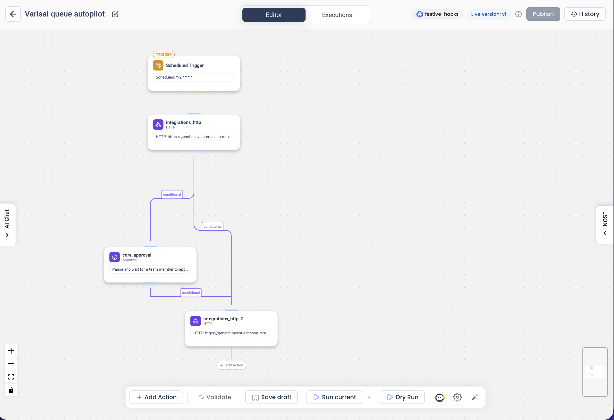

# Varisai: one QR for every queue at an Indian wedding

At an Indian wedding the queues are everywhere: the mehendi artist, the nail-art table, the chaat counter, the blessing line on stage and the dining hall that seats in rounds. Guests spend the evening standing in lines instead of with their family, elders wait on their feet, and the planner has no idea which booth is drowning until someone complains. **Varisai** (வரிசை, "queue") turns every line into a virtual queue. A guest scans one QR at the venue, joins up to three queues at once from their phone, keeps mingling, and gets a full-screen "your turn" alert (spoken in their own language) when it's time to walk over. Booth handlers call the next guest from a phone console; the planner watches every booth live on a venue map.

Built for Festive Hacks with three sponsor tools: **Sarvam AI** (spoken, translated alerts), **Flagsmith** (live flags + A/B test) and **NudgeBee** (ops workflow). See [Built with](#built-with).

## Demo logins

Any phone number works; the OTP is always **`123456`** (no SMS in the demo). Seeded users:

| Phone | Who | Lands on |
|---|---|---|
| `9000000001` | Wedding Planner (admin) | `/admin` |
| `9000000010` | Meena, Mehendi artist (handler: Mehendi table, Nail art, Chaat) | `/booth` |
| `9000000011` | Ravi, caterer lead (handler: Dining hall) | `/booth` |
| `9000000012` | Karthik, stage coordinator (handler: Sangeet + Muhurtham booths) | `/booth` |
| `9000000100` | Lakshmi Chithi, guest with a Bride-side family pass | `/w` |
| `9000000102` | Suresh Mama, guest with a Groom-side family pass | `/w` |
| `9000000103` … `9000000109` | Guests already checked in | `/w` |
| any other number | New guest (must verify presence first) | `/w` |

Mehendi and the feast (Kalyana Virundhu) are forced live by the seed, so the demo works at any hour. Sangeet and Muhurtham go live from the admin Events tab.

## Run it

Needs **Node 22.5+** (uses the built-in `node:sqlite`).

```bash
npm install
cp .env.example .env      # all keys optional
npm run dev               # server :3000 + Angular :4200 (proxied)
```

Open http://localhost:4200. The database (`varisai.db`) seeds itself when empty.

| Command | What it does |
|---|---|
| `npm run dev` | Server (tsx watch) and web (ng serve) together |
| `npm test` | Server tests (Vitest: engine, routes, ticker, socket, sponsors) |
| `npm run seed -w server -- --reset` | Wipe and re-seed the demo data (stop `npm run dev` first) |
| `npm run simulate` | Physical lines vs Varisai simulation (table below) |
| `npm run build && npm start` | Production: Express serves the Angular build on one port |

## Environment

| Variable | Required | Purpose |
|---|---|---|
| `PORT` | no (3000) | HTTP + socket.io port |
| `JWT_SECRET` | **yes in production** | Signs the session cookie |
| `SEED_LAT`, `SEED_LNG` | no | Venue location for the seeded geofence (150 m radius) |
| `DB_PATH` | no | SQLite file (default `varisai.db` at the repo root) |
| `SARVAM_API_KEY` | no | Translated, spoken "your turn" alerts |
| `FLAGSMITH_ENVIRONMENT_KEY` | no | Live feature flags + ETA A/B test (`ser.` key = local evaluation) |
| `OPS_TOKEN` | no | Bearer token for NudgeBee's `/api/ops/*` calls |
| `NUDGEBEE_WEBHOOK_URL` | no | Where long-queue alerts are pushed |

Every sponsor key is optional: without one, that feature is hidden or falls back to its default, and nothing errors. Keys stay on the server and never reach the web bundle.

## Roles

Roles come from per-wedding memberships in the database, never from the token.

| Role | Can |
|---|---|
| **Guest** | Verify presence, join up to 3 queues per event, go away / come back, cancel, claim a family pass |
| **Booth handler** | Operate assigned booths only: call next, start, done, skip, pause; seat feast rounds |
| **Admin** (planner) | Everything above, plus events, booth layout, handlers, pass quotas, passes, overview, venue screen |

## How the queues work

All rules live in `server/src/engine` as pure, unit-tested functions (no I/O, `now` is a parameter).

- **Presence.** Joining a queue needs proof you're at the venue: either GPS inside the geofence (accuracy-aware), or the 4-digit code on the venue screen, which rotates every 30 s (HMAC of a secret + time window). Scanning the venue QR does it in one step. Valid for 12 h.
- **Live queues** (mehendi, nails, chaat, blessing). Each booth has N artists. *Call next* serves first-in, first-out, but lets one family-pass guest in after every 3 regulars. A guest who is busy at another booth is skipped over without losing their place, so holding 3 queues at once just works. Not there within 3 min → moved back 3 places; a second miss → released. "I'm away" holds the place for 20 min.
- **"Almost your turn."** The next (artists + 1) guests who are free get a nudge to start walking, so artists don't sit idle waiting for someone to cross the hall.
- **Feast rounds.** The dining hall seats in rounds (e.g. 160 seats, 25 min). Each round is filled first-fit in queue order, family-pass guests first, and a family is never split across rounds.
- **ETA.** Live: people ahead ÷ artists × average service time × the booth's learned speed (an average updated after every guest), shown as a range rounded to 5 min. Feast: rounds ahead × round length + time left in the current round.
- **Family passes.** The planner sets per-event quotas for each side (e.g. 40 Bride, 25 Groom). Generating a pass is all-or-nothing against those quotas; the QR link can be claimed once, by one phone. Revoking frees the quota. A pass never skips the presence check.

## Simulation

`npm run simulate` runs the same 400 seeded guests through a 2-hour Mehendi evening with dinner, twice: once in physical lines (one line at a time) and once with Varisai (join every queue on arrival, walk over when nudged). Calls use the real engine (`callNext`, `almostDue`, `buildRound`). Booths: Mehendi table ×10 artists, Nail art ×4, Chaat counter ×5, Dining hall 160 seats / 25 min rounds.

Seed 2026 · 400 guests · 621 booth visits:

| Metric | Physical lines | Varisai | Change |
|---|---:|---:|---:|
| Avg standing per guest (min) | 24.8 | 5.6 | −78% |
| p90 wait per booth visit (min) | 37.3 | 64.3 | +72% |
| Total guest-hours standing | 165.7 | 37.3 | −78% |
| Avg time to finish all booths (min) | 48.9 | 46.4 | −5% |

How to read it: guests stand about **a fifth as long**, and still finish everything slightly sooner. The p90 per-visit wait is *higher* with Varisai because a guest waits in up to three queues at the same time, so each queue's clock runs while they are being served somewhere else. They are seated or mingling for that time, not standing in line. Varisai's walks count as standing; walks between physical lines don't, so the comparison leans against Varisai. A different seed (`SEED=7`) gives −79% standing and −2% finish time.

The simulation also changed the product. In its first version the "almost" nudge went to positions 1–2. Those guests were often seated at the feast, so the guest actually called hadn't been told to walk over and the chaat servers sat idle: guests finished 25–30% *later* than with physical lines. Nudging the next free guests instead fixed it.

## Built with

**Sarvam AI.** When a guest is called, the line "Lakshmi, it's your turn at Mehendi table. Token M-014." is translated with **Mayura** into the guest's chosen language (Tamil, Hindi, Kannada, Telugu, Malayalam or English) and spoken with **Bulbul** (`bulbul:v4-flash`). The full-screen takeover on their phone plays it. The "almost" and feast-round notes are translated too. The audio is generated after the database commit, cached by (language, text), and pre-warmed at the "almost" nudge, so a slow API never delays a ticket. Without `SARVAM_API_KEY` the guest just sees the visual alert.

**Flagsmith.** Live kill-switches the planner can flip mid-event without a redeploy: `family_passes` (VIP lane and pass claims), `feast_rounds`, `voice_alerts` and `presence_geofence` (code-only presence when indoor GPS is bad). The server refreshes every 15 s and pushes changes to every phone over the socket. A multivariate `eta_style` flag runs an **A/B test** per guest: "~15–20 min" vs "3 people ahead". Each join and each guest cancel is logged, and the admin Overview shows the cancel rate for each wording. The server also enforces the switches (403 `feature_off` / `geofence_off`), not just the UI.

**NudgeBee.** An ops autopilot for the planner, with a human in the loop. The "Varisai queue autopilot" workflow runs every 2 minutes: an **HTTP** step calls `GET /api/ops/overview`. If any booth's wait is over 25 min, an **Approval** step asks the planner, for example "Mehendi table: 83 min, 4 waiting. Open one more artist?". On approve, a second **HTTP** step calls `POST /api/ops/booths/:id/artists`, and every waiting guest's ETA drops live. In testing, one approval took the Mehendi table from 2 to 3 artists and its wait from 83 to 55 min. Varisai can also push a booth to a NudgeBee webhook trigger the moment it first passes 25 min (`NUDGEBEE_WEBHOOK_URL`, deduped per booth per 15 min).
Endpoints: `GET /api/ops/overview` and `POST /api/ops/booths/:id/artists` (`Authorization: Bearer $OPS_TOKEN`, 401 when unset).



## Roadmap

- Slot booking (pick a time instead of queueing)
- Family-only booths
- Coordinator role (a relative who manages a group's tickets)
- Six more event types (Haldi, Nalangu, Reception, …)
- Drag-and-drop layout editor
- WhatsApp alerts for guests without the page open
- Anti-starvation for large families in feast rounds (today a family of 8 can be passed over by smaller parties that fit)
